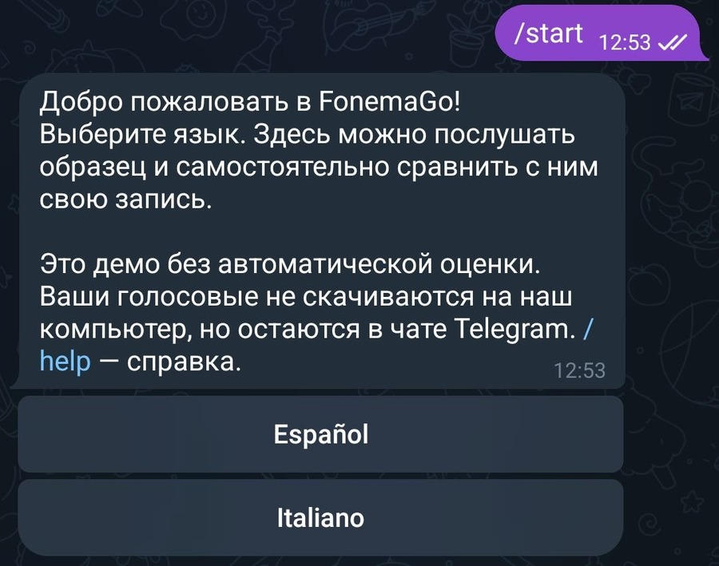
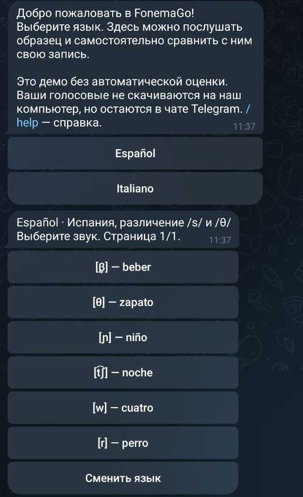
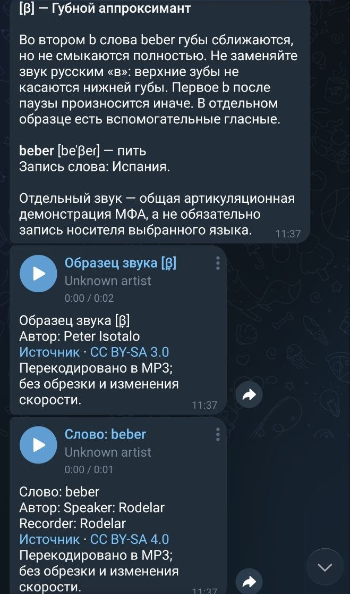
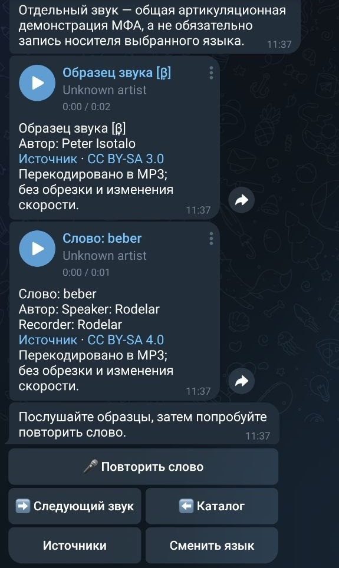
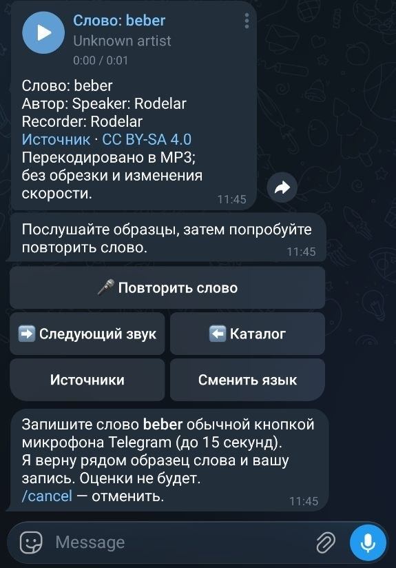
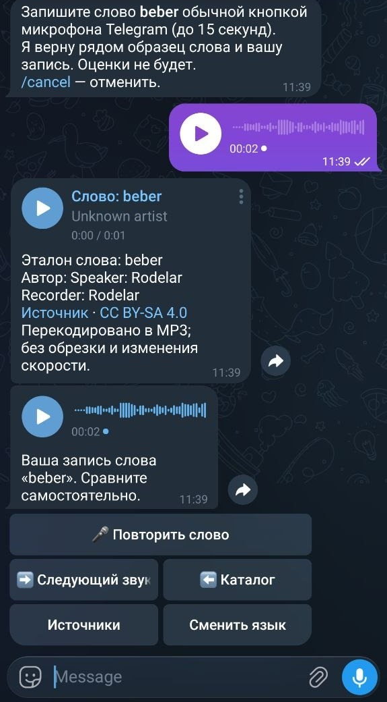
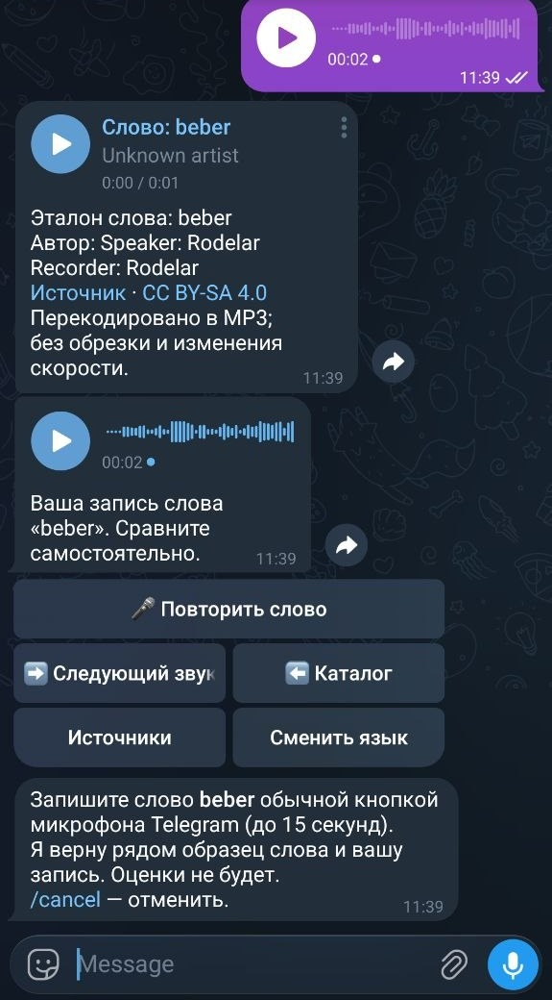
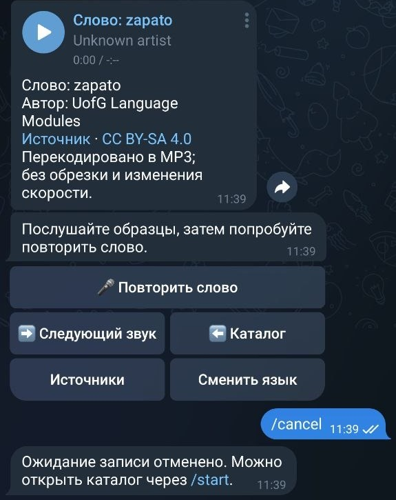

# FonemaGo — инструкция пользователя

## 0. Введение

- **Название проекта:** FonemaGo.
- **Ссылка на MVP:** [открыть @fonemago_bot в Telegram](https://t.me/fonemago_bot).
- **Для кого:** для русскоязычных пользователей, изучающих испанский или итальянский и желающих самостоятельно тренировать отдельные звуки и произношение слов.
- **Что делает:** бот показывает подсказку по произношению, даёт послушать образцы звука и слова, а затем возвращает вашу запись рядом с образцом для самостоятельного сравнения.
- **Время знакомства:** ориентировочно 5 минут до первого сравнения своей записи с образцом.

В демо доступны **два языка и по шесть звуков на каждый**: испанский Испании с различением /s/ и /θ/ и стандартный итальянский. Интерфейс и пояснения — на русском.

**Важно:** автоматической оценки, распознавания речи и баллов нет. Результат занятия — возможность услышать различия между своей записью и образцом, а не заключение о правильности произношения.

## 1. Первый вход в продукт

Понадобятся аккаунт Telegram, интернет, возможность слушать аудио и микрофон для записи. Устанавливать отдельное приложение FonemaGo не нужно.

1. Перейдите по ссылке [@fonemago_bot](https://t.me/fonemago_bot) и откройте **личный чат** с ботом: в группах он не работает.
2. Нажмите **Start / «Начать»**. Если чат уже открыт, отправьте команду `/start`.
3. Прочитайте приветствие. Бот предложит выбрать язык и объяснит, что сравнение выполняется самостоятельно, без автоматической оценки.
4. Найдите под приветствием кнопки **Español** и **Italiano**. Далее выберите язык по инструкции в разделе 2.

Отдельная регистрация не требуется. Вводить имя, телефон, почту или пароль в чат бота не нужно.

**Первый экран:** сообщение «Добро пожаловать в FonemaGo! Выберите язык…», пояснение о демо и две кнопки выбора языка.

*Рисунок 1. Первый вход: приветствие после /start и выбор языка.*

## 2. Основная функция №1 — выбор языка и звука

**Зачем нужна:** помогает найти нужное упражнение в готовом каталоге, не вводя слово или фонетический символ вручную.

### Пошаговая инструкция

1. Под приветствием нажмите **Español** для испанского или **Italiano** для итальянского.
2. Дождитесь сообщения с названием языка, его вариантом и предложением «Выберите звук». Время ответа зависит от соединения и доступности бота; точное время не гарантируется.
3. Найдите нужную кнопку: на каждой указаны звук в транскрипции и пример слова. Для первого занятия выберите **[β̞] — beber** в испанском каталоге.
4. Нажмите эту кнопку. Бот пришлёт карточку выбранного звука и аудиопримеры — работа с ними описана в разделе 3.

**Пример входных данных:** нажатия **Español** → **[β̞] — beber**. Текст, фото или файл отправлять не нужно.

**Пример результата:** выбран испанский звук [β̞] и открыто упражнение со словом **beber** («пить»).

Чтобы вернуться к списку звуков, нажмите **«⬅️ Каталог»** под карточкой. Для другого языка нажмите **«Сменить язык»** или отправьте `/language`.

*Рисунок 2. Шаги 1–3: после выбора Español появляется каталог; для упражнения beber нажмите первую кнопку со звуком [β̞]. Результат шага 4 показан на рисунке 3.*

## 3. Основная функция №2 — изучение карточки и прослушивание образцов

**Зачем нужна:** показывает, как произносится звук отдельно и в слове, и объясняет, на что обратить внимание при повторении.

### Пошаговая инструкция

1. Откройте **[β̞] — beber** по инструкции из раздела 2.
2. Прочитайте название звука, подсказку, слово, транскрипцию и перевод. **МФА** — международный фонетический алфавит: его символы обозначают звуки, а не написание слова.
3. Дождитесь двух аудиосообщений. Запустите кнопкой воспроизведения первое — **«Образец звука [β̞]»**.
4. Затем прослушайте второе — **«Слово: beber»**. При необходимости воспроизведите оба ещё раз.
5. Обратите внимание на второе **b** в слове: губы сближаются, но не смыкаются полностью; верхние зубы не касаются нижней губы. Первое **b** после паузы произносится иначе.

**Пример входных данных:** выбранная карточка **[β̞] — beber** и нажатия на воспроизведение аудио.

**Пример результата:**

| Элемент карточки | Что вы увидите или услышите |
| --- | --- |
| Звук | [β̞] — Губной аппроксимант |
| Слово | **beber** |
| Транскрипция | [beˈβ̞eɾ] |
| Перевод | пить |
| Вариант записи слова | Испания |
| Аудио | Отдельный образец звука и запись слова |

Отдельный звук — общая артикуляционная демонстрация МФА, не обязательно запись носителя выбранного языка. В некоторых образцах есть вспомогательные гласные. Для произношения целого слова ориентируйтесь на **запись слова**.

Кнопка **«Источники»** открывает ссылки и сведения о проверке материала. Автор, источник и лицензия аудио указаны в подписях к записям. Материалы отобраны для демо по открытым источникам; независимой экспертной и слуховой проверки не было.

*Рисунок 3. Карточка beber: прочитайте подсказку и транскрипцию, затем прослушайте отдельный звук и слово кнопками ▶.*

*Рисунок 4. Два аудиопримера с указанием источников и лицензий. Под ними — кнопка «🎤 Повторить слово» для перехода к записи.*

## 4. Основная функция №3 — запись слова и самостоятельное сравнение

**Зачем нужна:** завершает цикл «послушать → повторить → сравнить», чтобы вы могли заметить различия на слух и попробовать ещё раз.

### Пошаговая инструкция

1. Под открытой карточкой нажмите **«🎤 Повторить слово»**.
2. Дождитесь сообщения «Запишите слово beber обычной кнопкой микрофона Telegram…». **Кнопка бота сама не включает микрофон.**
3. В поле ввода Telegram найдите кнопку микрофона. Если вместо неё показана камера видеосообщения, переключитесь на голосовое сообщение. При необходимости разрешите Telegram доступ к микрофону.
4. Запишите слово **beber** и отправьте его как обычное **голосовое сообщение**, а не как прикреплённый аудиофайл. Ограничения демо: **не более 15 секунд и 1 МиБ (1 048 576 байт)**.
5. Дождитесь ответа. Бот пришлёт аудио **«Эталон слова: beber»**, затем ваше голосовое с подписью **«Ваша запись слова «beber». Сравните самостоятельно.»** Время доставки зависит от Telegram и соединения.
6. По очереди воспроизведите эталон и свою запись. Сравните звучание второго **b**, ударение и ритм слова, учитывая подсказку в карточке.
7. Чтобы повторить попытку, снова нажмите **«🎤 Повторить слово»** и отправьте новое голосовое. Для продолжения нажмите **«➡️ Следующий звук»**, для выбора другого упражнения — **«⬅️ Каталог»**.

**Пример входных данных:** короткое голосовое сообщение, в котором вы произносите **beber**.

**Пример результата:** два последовательных сообщения для прослушивания — эталон слова и ваша запись. Бот не сообщает, правильно ли вы произнесли слово, и не проверяет, какое слово записано.

Если передумали записывать, отправьте `/cancel`: ожидание записи отменится.

*Рисунок 5. Перед записью: нажмите «🎤 Повторить слово», дождитесь приглашения и запишите слово обычной кнопкой микрофона Telegram справа внизу.*

*Рисунок 6. Запись и результат: сверху — приглашение и отправленное голосовое, ниже — эталон и ваша запись для самостоятельного сравнения. Микрофон Telegram находится справа в поле ввода.*

*Рисунок 7. Повторная попытка: после нового нажатия «🎤 Повторить слово» бот снова предлагает записать beber. Для другого упражнения доступны «➡️ Следующий звук» и «⬅️ Каталог».*

*Рисунок 8. Отмена записи: команда /cancel и подтверждение бота. Здесь уже открыто следующее упражнение — zapato.*

## 5. Что делать, если что-то пошло не так

| Проблема | Что делать |
| --- | --- |
| Бот не отвечает на `/start` | Проверьте интернет и убедитесь, что открыли личный чат с @fonemago_bot. Подождите и повторите команду. Если ответа по-прежнему нет, бот может быть временно недоступен — попробуйте позже. |
| «Сначала откройте карточку звука и нажмите «Повторить слово»» | Откройте нужную карточку, нажмите **«🎤 Повторить слово»**, дождитесь приглашения и отправьте запись снова. После перезапуска бота ожидание записи сбрасывается. |
| «Слишком длинная запись» или «Файл слишком большой» | Запишите только слово: голосовое должно быть не длиннее **15 секунд** и не больше **1 МиБ**. Не прикрепляйте аудиофайл вместо голосового. |
| «Эта кнопка от другой карточки» или «Кнопка устарела или неверна» | Отправьте `/start`, выберите язык и заново откройте нужный звук. Используйте кнопки под актуальной карточкой. |
| Не пришёл образец или появилось «Не удалось выполнить действие» | Проверьте соединение и заново откройте карточку через `/start`. Не нажимайте кнопки много раз подряд. |
| Telegram не даёт записать голосовое | Проверьте разрешение на микрофон в настройках приложения или браузера и выберите режим голосового, а не видеосообщения. |
| «Подождите секунду» или «Дождитесь предыдущего действия» | Подождите завершения предыдущего действия и нажмите нужную кнопку один раз. |

Справка в любой момент доступна по команде `/help`.

## 6. Частые вопросы (FAQ)

### Нужно ли знать фонетическую транскрипцию?

Нет. Начните со слова-примера, русской подсказки и аудио. Символы МФА помогают различать звуки, но для первого занятия достаточно прослушать и повторить образец.

### Почему бот не поставил оценку моей записи?

В MVP нет ИИ-оценки и распознавания речи. Он возвращает образец и вашу запись для самостоятельного сравнения. Для профессиональной обратной связи нужен преподаватель.

### Какие языки и звуки доступны?

В демо по шесть карточек для испанского и итальянского. Испанский набор ориентирован на вариант Испании с различением /s/ и /θ/; итальянские транскрипции — стандартные, регион записей слов не указан. Переключить язык можно через `/language` или кнопку **«Сменить язык»**.

### Где хранятся записи и как удалить мои данные?

Голосовые не скачиваются на оборудование владельца бота и остаются в Telegram-чате. В рабочей базе хранятся Telegram ID и текущий выбор, но не имя и не история занятий. Команда `/forget` удаляет ID и выбор из рабочей базы, **не удаляя сообщения в Telegram и ранее созданные резервные копии**. Сообщения в чате удаляются средствами Telegram.

### Можно ли отменить запись или начать занятие заново?

Да. `/cancel` отменяет ожидание голосового, `/start` возвращает к выбору языка, **«⬅️ Каталог»** — к списку звуков. Для новой попытки откройте упражнение и нажмите **«🎤 Повторить слово»**.

---

**Для владельцев и разработчиков:** [запуск под Linux](docs/run-linux.md), [документация разработчика](docs/development.md), [проверка учебных материалов](docs/content-review.md).
